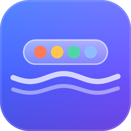
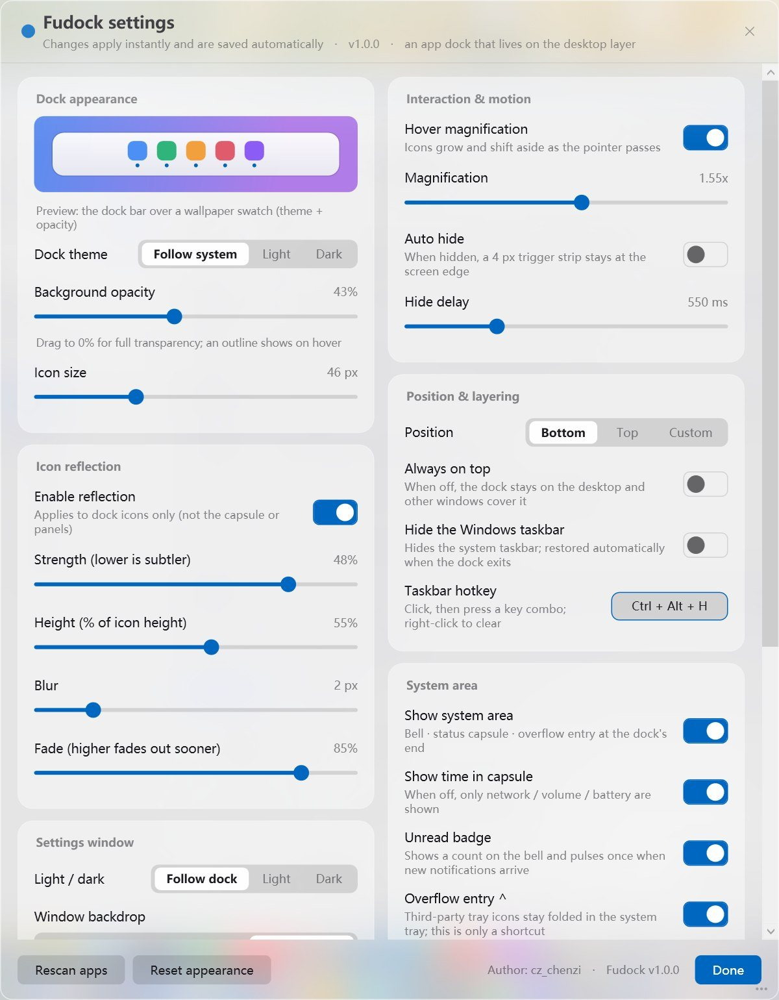

# Fudock — a desktop-layer dock for Windows 11



[中文](README.md) | **English**

[](../../releases)
[](LICENSE)
[](#)
[](#)

Fudock is a Windows 11 dock written in plain **C# + WPF**. It does one small thing: **it puts the dock
back on the desktop**. By default it is *not* topmost — it sits at the bottom of the window stack, so a
maximised browser covers it and `Win + D` (or minimising your windows) brings it back. It never blocks
your content, and a single switch turns it into a classic always-on-top dock.

**One 284 KB exe, zero runtime.** No .NET SDK, no Node/Electron, no admin rights — just the
.NET Framework 4.8 that ships with Windows. Unzip, double-click, done.
The interface switches between **Chinese and English** with one click.



## Features

| Feature | What it means |
| --- | --- |
| **Desktop layer, or topmost** | Covers nothing by default; one toggle for classic always-on-top behaviour |
| **Fluent settings panel** | Fully hand-drawn cards (no default WPF controls), changes apply and save instantly, drag any edge to resize, double-click the title to reset |
| **Fully transparent mode** | 0% opacity is literally invisible; hovering reveals a faint outline so the bar is still findable and clickable |
| **Icon reflection** | Strength / height / blur / fade, and the bar grows to make room |
| **System area** | Unread badge on the bell, status capsule (network / volume / battery / time), and a `^` entry that lists your background tray apps directly |
| **Window previews** | Hover an icon for a live thumbnail; switch between windows of the same app |
| **Drag to use** | Drop an `exe` / `lnk` / `bat` on the bar to add it; drag icons to reorder |
| **Tray, autostart, single instance** | `Ctrl + Alt + H` hides/restores the Windows taskbar, optional autostart, a second launch exits immediately |
| **Chinese / English** | Switch in Settings, or start with `Fudock.exe --lang=en` |

## Install (30 seconds)

1. Download `Fudock-1.0.0.zip` from **[Releases](../../releases)** and extract it anywhere
   (for example `D:\Apps\Fudock`).
2. **Double-click `Fudock.exe`** — the dock appears at the bottom of the screen.
3. Right-click the dock → "Dock settings…" to tune it; right-click → "Start with Windows" if you want autostart.

> **First run:** the exe is not code-signed (personal project), so Windows SmartScreen may show
> "Windows protected your PC". Click **More info → Run anyway**. The release page lists a SHA-256 you can verify.

## Settings at a glance

| Setting | Notes |
| --- | --- |
| Icon size | 24–96 px |
| Hover magnification / factor | Icons grow *and* shift aside |
| Auto hide / delay | A 4 px trigger strip stays at the screen edge |
| Background opacity | 0–100%, 0 = fully transparent (outline on hover) |
| Position | screen bottom / top / **custom** (drag & save) |
| Theme | follow system / dark / light |
| Always on top | off = desktop layer (default), on = classic dock |
| Settings window | own light/dark, opacity, corner radius (0–26 px), backdrop: none / frosted / glass |
| Icon reflection | enable, strength, height, blur, fade |
| System area | bell, capsule time, unread badge, `^` overflow, fullscreen auto-hide, panel animation, single-click-opens-panel |
| Language | 中文 / English |
| Taskbar hotkey | record a combo (default `Ctrl + Alt + H`), right-click to clear |
| Start with Windows | writes one `HKCU\...\Run\Fudock` value |

Data lives in `%APPDATA%\Fudock\` — `settings.json` and `error.log`. Nothing else is touched.

**Uninstall:** tray icon → Quit, delete the program folder, delete `%APPDATA%\Fudock`. The autostart
entry is removed on exit.

## Build from source

No SDK required — the build uses the C# compiler bundled with Windows:

```powershell
.\build.cmd               # or: powershell -ExecutionPolicy Bypass -File .\build.ps1
.\build.ps1 -Run          # build and start
powershell -ExecutionPolicy Bypass -File .\tools\pack.ps1 -Version 1.0.0   # release zip
```

`build.ps1` compiles `src\*.cs` with `C:\Windows\Microsoft.NET\Framework64\v4.0.30319\csc.exe`
into a single `build\Fudock.exe` and embeds `app.ico`; the icon itself is generated by
`tools\make-icon.ps1` (seven drawing styles: `wave`, `pier`, `boat`, `fbar`, `dock`, `letter`, `hanzi`).

## Known limits

- Docks on the **primary monitor** only (uses `SystemParameters.WorkArea`).
- **UWP / Store apps** are hosted by `ApplicationFrameWindow` with no usable file path, so they can't be pinned.
- Apps that require **elevation** won't trigger UAC from the dock (Windows UIPI limitation).
- Targets **.NET Framework 4.8**, so Windows 10 / 11 only.

## License & credits

MIT — see [LICENSE](LICENSE). Author: **cz_chenzi**.

The complete technical write-up (window layering, magnification algorithm, tray UIA bridge, taskbar
recovery strategy, reliability rules before publishing…) lives in the Chinese [README.md](README.md),
which is also where feature-by-feature screenshots are documented.
