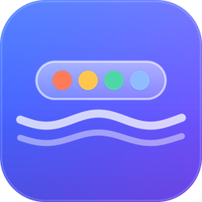
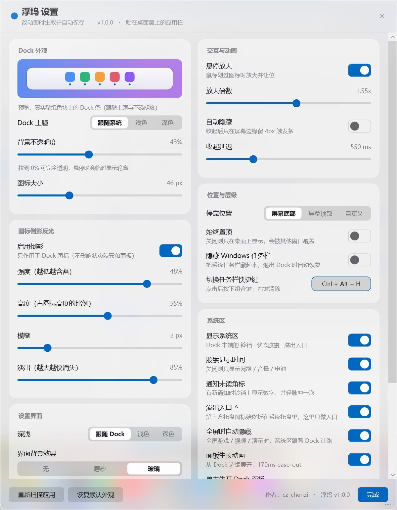
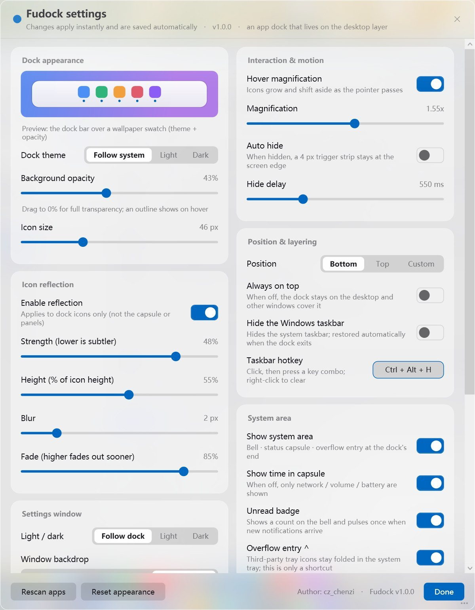

# 浮坞 Fudock — 贴在桌面层的 Windows 11 Dock 栏



**中文** | [English](README.en.md)

[](../../releases)
[](LICENSE)
[](#)
[](#)

一个用**纯 C# + WPF** 写的 Windows 11 桌面 Dock 栏。它做的一件小事是**把 Dock 放回桌面**：
默认不置顶，待在窗口栈最底层——打开浏览器就被正常盖住，`Win + D` 或最小化所有窗口它又回来，
既不挡内容也不丢功能；想让它在最上层（老式 Dock 行为）也只需要一个开关。

**单文件 284 KB，零运行时依赖**：不需要 .NET SDK、不需要 Node/Electron、不需要管理员权限，
只依赖 Windows 自带的 .NET Framework 4.8，解压双击就能用。界面**中文 / English** 一键切换。

| 能力 | 说明 |
| --- | --- |
| **桌面层 / 置顶可切** | 默认被窗口覆盖，绝不挡内容；需要时一键置顶（见 0 节） |
| **Fluent 设置面板** | 全自绘卡片界面，改动即时生效并自动保存，可拖边角缩放、双击标题复位（见 0.5 / 0.12 节） |
| **完全透明** | 0% 时肉眼全透明；悬停显出一层细轮廓，保证还找得到、点得中（见 0.11 节） |
| **图标倒影** | 强度 / 高度 / 模糊 / 淡出四项可调，开启后 Dock 自动增高让位（见 0.11 节） |
| **系统区** | 铃铛未读角标 + 状态胶囊（网络 / 音量 / 电池 / 时间）+ `^` 直接列出后台托盘应用（见 0.8 节） |
| **多窗口预览** | 悬停图标看实时缩略图，同应用多窗口可直接切换（见 0.8 节） |
| **拖拽即用** | 把 exe / lnk / bat 拖上 Dock 即添加，拖动图标即排序（见 1 节） |
| **托盘 / 自启 / 单实例** | `Ctrl + Alt + H` 隐藏任务栏、开机自启、重复启动不会再开一个 |
| **中英双语** | 设置里一键切换，或 `Fudock.exe --lang=en`（见 0.13 节） |

## 安装（30 秒）

1. 到 **[Releases](../../releases)** 下载 `Fudock-1.0.0.zip`，解压到任意目录（例如 `D:\Apps\Fudock`）。
2. **双击 `Fudock.exe`**，Dock 出现在屏幕底部。
3. 右键 Dock →「Dock 设置…」按喜好调；想开机自启，右键 Dock →「开机自动启动」。

> **首次运行提示**：exe 没有代码签名（个人项目），Windows SmartScreen 可能提示"已保护你的电脑"，
> 点「更多信息 → 仍要运行」即可。发布页附有 SHA-256，可先校验文件完整性。

- **数据位置**：只在 `%APPDATA%\Fudock\`（`settings.json` 配置、`error.log` 日志）；
  除你主动开启自启时写一条 `HKCU\Software\Microsoft\Windows\CurrentVersion\Run\Fudock` 外，不动注册表。
- **卸载**：托盘右键「退出」→ 删除程序目录 → 删除 `%APPDATA%\Fudock`（自启项在退出时自动清理）。
- **要求**：Windows 10 / 11（x64 或 ARM64），系统自带 .NET Framework 4.8。
- **给用户的一页说明**：[`readme.txt`](readme.txt)（中英对照）。

想从源码编译、或者想看每个交互是怎么实现（放大让位、分层窗口、托盘 UIA 桥、任务栏自动隐藏恢复…），
下面这些章节就是完整的技术记录，按功能从 0 开始编号。

---

## 0. 显示层级：Dock 是"桌面的一部分"

默认情况下 Dock **不置顶**，它待在窗口栈最底层（桌面之上、所有应用窗口之下）：

- 打开浏览器或任何应用 → **Dock 被正常覆盖**，绝不挡内容；
- 按 `Win + D` 显示桌面、或最小化全部窗口 → **Dock 重新出现**；
- 想临时看它又不想动浏览器 → 点托盘图标的「显示 / 隐藏 Dock」。

想让 Dock 一直浮在最上层（老式 Dock 行为），勾选右键菜单 / 设置面板里的
**「始终置顶显示（会盖住其他窗口）」** 即可，两种模式随时切换、立即生效。

> 打开浏览器时 Dock 被正常盖住；按 `Win + D` 或最小化所有窗口后它重新出现。

---

## 0.5 设置面板

> 面板支持浅色 / 深色两套外观：跟随 Dock，或独立指定。

面板是**全部自绘的 Fluent 卡片界面**——没有用任何默认 WPF 控件（默认 Slider / CheckBox / ComboBox
是 Win7 观感，跟 Dock 完全不搭）。里面分成**两套互不干扰的外观设置**：

**① Dock 外观**（作用于 Dock 条本身）

- **Dock 主题**：`跟随系统 / 浅色 / 深色`，点完 Dock 条立刻换肤；
- **背景不透明度**：20%–100%，卡片顶部有「渐变壁纸 + 迷你 Dock 条」的**实时预览**；
- **图标大小**：24–96 px。

**② 设置界面**（只作用于这个设置窗口本身，跟 Dock 互不影响）

- **深浅**：`跟随 Dock / 浅色 / 深色` —— 可以让 Dock 保持浅色、设置窗单独用深色；
- **界面透明度**：55%–100%，拖动时窗体底板和卡片实时变透明；
- **圆角半径**：0–26 px，**拉到 0 就是直角（方角）界面** —— 卡片、按钮、开关、滑块、
  分段选择器会一起变成方角，数值栏显示「直角」（窗口最外层转角由系统决定，见 0.7）。

其余：放大倍数 / 收起延迟滑块、各种 Fluent 开关、重新扫描应用 / 恢复默认外观 / 完成。

面板的层级也做了处理：**窗口获得焦点时置顶**（保证一定看得见），
**失去焦点后自动放下**（不赖在浏览器前面），拖动标题区可移动窗口，`Esc` 关闭。

---

## 0.6 自定义位置（拖动 + 保存）

Dock 不只能贴边，还能停到屏幕任意地方：

**怎么进入**

- 右键 Dock 空白处 → 停靠位置 → **自定义位置（拖动调整）…**
- 或托盘右键 → 自定义 Dock 位置…
- 或设置面板 → 停靠位置 → **自定义**

**进入后**

- Dock 会加一圈强调色描边并**浮到最上层**（不会被浏览器挡住），图标暂时不响应点击，**整条都能拖**；
- 旁边出现一条提示：「拖动 Dock 到任意位置　取消 / 保存位置」；
- 拖动时靠近屏幕**水平中线**、**上边缘 / 下边缘**会自动吸附对齐；
- 点 **保存位置** → 写入配置并立即生效；点 **取消** 或按 `Esc` → 回到拖动前的样子。

**保存的是什么**

存的是 Dock 条中心相对工作区的**归一化坐标**（`PosX / PosY`，0~1 的比例），
所以换分辨率、改缩放、外接显示器后，Dock 会回到同一个**相对位置**而不是飘到屏幕外。
存成自定义位置后，自动隐藏会自动停用（中间悬浮的 Dock 没"边缘"可藏）。

---

## 0.7 界面背景效果（无 / 磨砂 / 玻璃）

设置面板 →「设置界面」卡片里的 **界面背景效果**，三档：

| 档位 | 实现 |
| --- | --- |
| 无 | 关掉系统材质，纯色面板 |
| 磨砂 | Win11：`DWMWA_SYSTEMBACKDROP_TYPE = DWMSBT_TRANSIENTWINDOW`（系统亚克力，自带噪点）；旧系统退回 `SetWindowCompositionAttribute` + `ACCENT_ENABLE_ACRYLICBLURBEHIND` |
| 玻璃 | **玻璃拟态**：系统亚克力作底 + WPF 叠层 —— 约 10% 白半透底色、1px 白内亮边、顶部柔和折射高光、两团大块柔光（**浅色主题用纯白**，深色用青蓝 + 紫，低透明度保证文字清晰），卡片改为半透明白 + 白描边 + 更大圆角 |

为了吃系统材质，设置窗口是**非分层窗口**：`WindowChrome(GlassFrameThickness=-1)`
+ `CompositionTarget.BackgroundColor = Transparent`，客户区整体当作“玻璃框”。

轮廓分两层：

- 「圆角半径」作用于外壳描边、卡片、按钮、开关、滑块、分段选择器这些 WPF 自己画的部分，
  拉到 0 全部变方角；底部描边铺满整个窗口矩形，保证材质从边到角都是满的。
- **窗口最外层转角交给系统**（Win11 默认约 8 px）。
  原因是 **DWM 的系统材质不受窗口区域约束**——实测用 `SetWindowRgn` 裁成圆角时，
  圆角外的直角区照样被材质涂上（角上 `#D3D3D3`、窗内 `#E0E0E0`），
  看起来就是"遗留的直角边"；换成 DWM 自己的圆角后，材质会被一起裁圆，边缘平滑无缝。
  所以滑块控制不到最外层转角。

高 DPI 下（PerMonitorV2）纹理与描边都是矢量渐变/1px 实线，不开位图缩放，所以任何缩放下都清晰。

> 界面背景效果三档：**无 / 磨砂 / 玻璃**，只影响设置面板自身，不影响 Dock 条。

> Dock 条本身**不提供**背景效果切换：它是逐像素透明的分层窗口，
> DWM 材质会把整个窗口矩形刷成一块（连带放大溢出的留白区一起被涂黑），
> 还会吃掉空白区的鼠标穿透。Dock 条的观感由「背景不透明度 + 主题」控制。

---

## 0.8 系统托盘与通知入口（Dock 末端的三段式系统区）

Dock 末端不是一个迷你任务栏，而是**三个入口**：

```
[ 铃铛 ]  [ (网络)(音量)(电池) 100% · 18:20 ]  [ ^ ]
```

| 段 | 做什么 | 单击 |
| --- | --- | --- |
| 通知铃铛 | 有新通知时右上角出角标（数字）并轻脉冲一次；不弹自己的 toast | `Win + N` 打开 **Windows 通知中心** |
| 状态胶囊 | 网络 / 音量 / 电池·电源 / 时间揉成**一个药丸**，不是四个独立小图标 | `Win + A` 打开 **Windows 快速设置** |
| 溢出入口 ^ | 第三方托盘图标**永远折叠**，这里只是一个入口 | 打开本项目的「系统托盘」面板，一键展开系统托盘 / 跳任务栏设置 |

三条原则：

1. **不重造系统面板**：通知中心、快速设置都交给 Windows 自己，Dock 只负责把用户送过去。
   系统面板打不开时（注入失败 / 精简系统 / 未来版本改了快捷键），同一个按钮**退回本项目面板**，不会点了没反应。
2. **不常驻第三方图标**：`^` 点开的是一张说明卡片 + 一个「展开系统托盘」，不把别人的图标复制一排。
3. **隐藏任务栏之后依然有出口**：这两条入口就在 Dock 上，不依赖任务栏。

### 任务栏的安全约定（踩过坑，写死）

`SW_HIDE` 掉 `Shell_TrayWnd` 会**把 Explorer 的自动隐藏状态机卡住**：之后鼠标移到屏幕底部，
任务栏再也不弹出来（现象就是"连 Windows 原生任务栏都打不开了"）。所以：

- `IsHidden` 不再用 `!IsWindowVisible` 判断（Windows 自己的自动隐藏会让它一会儿 true 一会儿 false，
  菜单里就会误显示成"已隐藏"，点一下反而真把任务栏藏了）——改成只看"我们有没有藏过"；
- 恢复任务栏时**必须**重新下发一次自动隐藏状态：
  `SHAppBarMessage(ABM_SETSTATE, lParam = ABS_AUTOHIDE|ABS_ALWAYSONTOP)`，否则状态机不会复位；
- 菜单里只有单向的「**显示** Windows 任务栏」，没有"点了会藏起来"的选项；
- 启动时若配置写着"不藏"、但我们之前藏过 → 立刻自动显示回来（自愈）；
- `退出 Dock` 始终 `RestoreTaskbar()`。

### 交互状态表

| 状态 | 铃铛 | 胶囊 | 溢出 ^ |
| --- | --- | --- | --- |
| **默认** | 灰铃铛（无角标） | 白药丸：网络 / 音量 / 电池 / 时间 | 描边 chevron |
| **悬停** | 按 Dock 规则轻微放大（≤1.4× 的图标行程），出现 Fluent 悬停底色 + tooltip | 同上，tooltip 分四行列出网络名 / 音量 / 电源 / 快捷键 | 同上，tooltip「系统托盘 · 第三方图标折在这里」 |
| **展开** | 系统通知中心（或本项目面板） | 系统快速设置（或本项目面板） | 本项目面板从 Dock 边缘长出（170ms ease-out） |
| **全屏**（游戏 / 视频 / 演示） | 整个系统区淡出并折叠，Dock 变窄，面板自动关闭 | 同左 | 同左 |
| **无通知** | 无角标、无脉冲 | — | — |
| **有未读** | 角标 `1..9+` + 一次 120ms 缩放脉冲（不震不闪） | — | — |

### 分级降级

| 级别 | 内容 | 失败时 |
| --- | --- | --- |
| **L1** | 状态胶囊 + 调用系统面板（`SendInput` 模拟 Win+A/Win+N） | 注入失败 → 退回本项目面板（面板里有「打开快速设置 / 打开通知中心」按钮） |
| **L2** | 通知未读角标（`SetWinEventHook` 盯 ShellExperienceHost + `wpndatabase.db` 写入时间兜底） | 全部失效 → 角标保持 0，退化成 L1 |
| **L3** | 第三方托盘溢出（`^`） | **已把后台应用直接铺进 Dock 面板**：用 UI Automation 读**两个来源**——① 任务栏上直接显示的托盘图标（XAML 宿主 `Windows.UI.Composition.DesktopWindowContentBridge`）② 折在溢出弹层里（`TopLevelWindowForOverflowXamlIsland`）的图标；点一下用 `InvokePattern.Invoke()` 把动作交回那个应用（可见的直接在任务栏上点，不用开弹层）。图标四级解析：① 系统条目用内置矢量图标（蓝牙/安全/音量/网络/电池）② 托盘名 vs 进程名/exe/文件说明/产品名 **精确匹配** ③ **包含匹配 + 中文别名表**（虚拟机→vmware、加速器→uu、显卡→amd/nvidia…）④ **单词交集打分**；全失败才退化成首字母块 | 枚举失败或超时 → 面板自动退回「刷新列表 / 展开系统托盘 / 任务栏设置」，不空转、不崩 |

L3 为什么不做"把别人图标读出来"：微软没有公开 API（`ITrayNotify` 是未文档化 COM，
UIA 要遍历 `NotifyIconOverflowWindow`，Win11 又换成了 XAML 岛），一旦系统改结构就会崩。
所以这一级只做"入口 + 交棒"，把不确定性关在系统自己那边。

> 系统区三段：铃铛（未读角标）· 状态胶囊（网络 / 音量 / 电池 / 时间）· `^` 溢出入口（直接铺出后台托盘应用）。

> **点开后台应用后不许抢它的 Esc**（1.0.0 修复）：点完托盘图标要收起溢出弹层，但这时前台已经是刚打开的应用了，
> 再发一个全局 `Esc` 会被它吃掉——微信 / QQ 收到 `Esc` 会把主窗口收回托盘，用户看到的就是"闪一下然后什么都没有"。
> 现在只有当前台仍是任务栏 / 弹层自己时才按 `Esc`（`TrayBridge.CloseOverflow()` + `IsShellSurface()`），否则直接放手让弹层自己消失。

### 需要的 Windows API / 权限

| 用途 | API | 权限 |
| --- | --- | --- |
| 打开快速设置 / 通知中心 | `user32!SendInput`（Win+A / Win+N） | 普通用户；不注入到别的进程，不做全局键盘钩子 |
| 全屏检测 | `shell32!SHQueryUserNotificationState` | 只读 |
| 电池 / 电源 | `kernel32!GetSystemPowerStatus` | 只读 |
| 音量 | Core Audio COM（`IMMDeviceEnumerator` + `IAudioEndpointVolume`） | 普通用户 |
| 网络 | `System.Net.NetworkInformation` 枚举网卡 | 无 |
| 通知未读探测 | `SetWinEventHook` + 读 `%LOCALAPPDATA%\Microsoft\Windows\Notifications\wpndatabase.db` 的文件时间 | 普通用户（库文件本身不开，只读时间戳） |
| 展开系统托盘 | Win10：`Shell_TrayWnd` → `TrayNotifyWnd` → `BM_CLICK`；**Win11：`Win+B` 聚焦托盘 → `Enter` 展开**（实测 `TopLevelWindowForOverflowXamlIsland` 由不可见变可见） | 普通用户；两条都失败才跳 `ms-settings:taskbar` |
| 图标归属（同一家多个产品） | 先跑【别名表】（带排除词：加速器排除 remote/viewer，远程只认 remote）；别名组内按【进程名】排序（uu.exe 优先于组件 uu_ball.exe）；包含匹配也要全量收集后再排序，不能先到先得 | 普通用户 |
| 读后台应用列表 / 点击 | UI Automation（`UIAutomationClient.dll`，GAC）：`FindAll(TreeScope.Descendants)` 取 `ControlType.Button` 的 `Name` + `BoundingRectangle`，点击用 `InvokePattern` | 普通用户，无需 UIAccess；UIA 被禁用时降级为「展开系统托盘」 |
| 叫出自动隐藏的任务栏 | `Win+B`（`FocusTray()`）——任务栏滑到屏幕外时，连 UIA 都读不到托盘区 | 普通用户 |

全部不需要管理员、不需要 UIAccess、不写系统目录。

### 配置项（设置面板 → 系统区）


| 项 | 默认 | 说明 |
| --- | --- | --- |
| 显示系统区 | 开 | 关掉后 Dock 恢复成纯图标条 |
| 胶囊显示时间 | 开 | 关掉只剩网络 / 音量 / 电池 |
| 通知未读角标 | 开 | 关掉铃铛变灰、不再脉冲 |
| 溢出入口 ^ | 开 | 图标本身始终折叠 |
| 全屏时自动隐藏 | 开 | 全屏游戏 / 视频 / 演示时让路 |
| 面板生长动画 | 开 | 关掉则面板直接出现（170ms 动画） |
| 单击先开 Dock 面板 | 关 | 关 = 单击胶囊/铃铛**直接**调系统面板；开 = 先开本项目面板（面板里再一键跳系统面板） |

---

## 0.9 作者

**cz_chenzi**（设置面板底部有署名）

---

## 1. 功能

### 外观
- **悬浮毛玻璃条**：半透明渐变背景 + 1px 高光描边 + 大圆角，深色 / 浅色两套配色，可跟随系统主题自动切换。
- **悬停放大（Magnify）**：鼠标靠近哪个图标，哪个图标就放大（1.0×–2.0× 可调），相邻图标平滑过渡并自动向两侧让位，效果与 macOS Dock 一致。
- **图标高清**：从系统 Jumbo 图标列表（256×256）取图，附带 EXIF 后缀和回退链（Jumbo → ExtraLarge → SHGFI 大图标 → 首字母占位块），高 DPI 下不发虚。
- **运行指示点**：应用正在运行 → 亮色圆点；仅固定未运行 → 暗色圆点；纯运行项未运行时自动消失。
- **淡入淡出动画**：自动隐藏滑出/收回带缓动，不闪不跳。

### 交互
| 操作 | 行为 |
| --- | --- |
| 左键单击图标 | 未运行 → 启动；单窗口 → 激活（已在前台则最小化）；多窗口 → 弹出窗口列表让你选 |
| 左键拖拽图标 | 抓起后图标**抬起放大**，拖到目标位置松手即保存顺序 |
| 右键单击图标 | 切换窗口 / 最小化·还原 / 关闭窗口 / 固定·取消固定 / 打开文件所在位置 / 设置 |
| 右键单击空白条 | 添加应用、设置、自动隐藏、悬停放大、**始终置顶**、**隐藏任务栏**、停靠位置、主题、开机自启、退出 |
| 右键单击系统区 | 快速设置 / 通知中心 / 通知设置 / 任务栏设置 / 显示时间 / 未读角标 / 隐藏系统区 / 退出 Dock 时恢复任务栏 |
| 拖入 exe / lnk / bat | 直接固定到 Dock（见下） |
| 鼠标离开 | 自动隐藏开启时按设定延迟收起，只留 4px 触发条 |
| **悬停图标** | **弹出该应用的窗口缩略图预览**（见下） |

### 窗口预览与切换

鼠标在**正在运行**的图标上停留约 0.43 秒，Dock 上方会弹出预览卡片：

- 每行一个窗口：**实时缩略图** + 窗口标题；多窗口按列堆叠（最多 5 行，超出提示"还有 N 个窗口"）；
- **点一下就切过去**（`AttachThreadInput` 强激活，不会被系统拦）；
- 缩略图右上角有 **✕**，悬停时出现，点击直接关掉那个窗口；
- 鼠标离开 Dock 和预览后自动收起（中间留了 2 帧宽限，从图标移到预览不会闪退）；
- 缩略图用 `PrintWindow(PW_RENDERFULLCONTENT)` 抓（GDI 双缓冲，缩放到 440px 宽省内存）；
- **最小化的窗口也能预览**：`PrintWindow` 抓不到隐藏窗口，所以 Dock 每 1.2 秒轮换抓 2 个可见窗口
  存进缓存（`ThumbnailCache`），最小化后回放**最后一次快照**，并在左下角标「已最小化」；
  从未抓到过的（比如启动 Dock 前就最小化的）才显示占位（应用图标 + "无法预览"）。

**归属怎么判定**：先按进程可执行文件路径精确匹配；不中时再沿**父进程链**往上找
（最多 4 层，遇到 `explorer.exe` / `cmd.exe` / `svchost.exe` 这类宿主进程就停）。
所以像 Steam 这种「窗口属于 `steamwebhelper.exe`、快捷方式指向 `Steam.exe`」的多进程应用
能正确归到同一个图标下，不会多冒出一个图标，预览也能正常弹出。

### 拖入即添加应用

把可执行文件拖到 Dock 条上，松手就固定：

- 拖拽经过时 Dock 会盖一层**「+ 松手添加到 Dock」**提示（不透明卡片 + 细分隔线 + 圆角，
  **配色跟随 Dock 的深浅色主题**），松手后显示「已添加到 Dock」；
- 支持从**桌面 / 资源管理器**拖（标准 `FileDrop`）；
- 也支持从**开始菜单 / 任务栏**拖 —— 这类拖放给的是 `Shell IDList Array`，
  代码会把 `CFSTR_SHELLIDLIST` 里的 `CIDA` 逐项 `SHGetPathFromIDList` 还原成真实路径；
- 支持 `.exe / .lnk / .bat / .cmd / .url`；重复项不会重复添加；
  类型不支持时提示「只能添加 exe / lnk / bat / cmd / url」。

右键菜单也换成了自绘的 Fluent 样式（不再是系统默认的方框菜单）：
圆角卡片 + 投影 + 圆角悬停高亮 + 强调色 ✓ 勾选 + 子菜单箭头，配色跟随 Dock 的深浅色主题。
菜单底色是**完全不透明**的，且投影单独一层渲染 —— 所以主菜单和子菜单的颜色永远一致
（不会因为背后是壁纸还是窗口而变色），文字也不会被投影糊到。

> 右键菜单是全自绘的 Fluent 卡，浅色 / 深色跟随 Dock 主题。

### 系统集成
- **桌面层显示**：窗口默认 `Topmost=false`，并在失去焦点时 `SetWindowPos(HWND_BOTTOM)` 主动沉到栈底，
  所以任何应用窗口都能把它盖住；勾选「始终置顶」则切回 `Topmost=true`。
- **隐藏原生任务栏**：`ShowWindow(SW_HIDE)` 作用在 `Shell_TrayWnd`（以及各显示器的 `Shell_SecondaryTrayWnd`）上。
  入口有三个：设置面板「位置与层级 → 隐藏 Windows 任务栏」、Dock 空白处右键菜单、托盘右键菜单。
  另外有**可自定义的全局快捷键**（默认 `Ctrl + Alt + H`）：设置面板里点一下那个键位框就直接录制新组合键
  （必须带 Ctrl/Alt/Shift/Win，避免抢占普通按键），右键可清除；改完立即重新 `RegisterHotKey`，
  注册失败（被别的程序占用）会在设置面板里显红提示。
  轮询里会检测任务栏是否被资源管理器重启"复活"并自动再压一次；
  **程序退出时会自动把任务栏还回去**，不会让你没任务栏可用。
- **真实窗口检测**：`EnumWindows` + 过滤 ToolWindow / 无标题 / DWM 隐藏(cloaked) 窗口，按进程可执行文件路径聚合，等价于任务栏的取样逻辑。
- **可靠的前台激活**：还原最小化窗口 + `AttachThreadInput` 解除前台锁 + `SetForegroundWindow`，失败再退 `SwitchToThisWindow`。切窗口不会被系统"静默拒绝"。
- **托盘图标**：左键显示/隐藏，右键菜单可快速进入设置或退出。
- **开机自启**：写 `HKCU\...\CurrentVersion\Run`，可在设置里开关。
- **单实例**：命名互斥体，重复启动不会开出第二个 Dock。
- **不抢 Alt+Tab**：窗口带 `WS_EX_TOOLWINDOW`，不出现在 Alt+Tab / 任务栏里。
- **高 DPI 感知**：manifest 声明 `PerMonitorV2`，缩放 125%/150% 下尺寸和位置依旧精确。

---

## 2. 快速开始

### 方式一：直接用现成的 exe
```
.\build\Fudock.exe
```
双击即可。首次运行会自动扫描开始菜单，挑出你机器上真实存在的常用应用（资源管理器、记事本、命令提示符、Edge、Office、QQ、Steam…）作为初始图标。

### 方式二：从源码重新编译
```
.\build.cmd
```
或
```powershell
powershell -ExecutionPolicy Bypass -File .\build.ps1 -Run
```
`build.cmd` 会调用 `tools\make-icon.ps1` 生成 `app.ico`，再用 Windows 自带的
`C:\Windows\Microsoft.NET\Framework64\v4.0.30319\csc.exe` 编译 `src\*.cs` → `build\Fudock.exe`。
全程离线、无 NuGet、无 SDK。

### 方式三：双击无黑框启动
`start-dock.vbs` —— 用 `WScript` 静默拉起 exe，适合放快捷方式到「启动」文件夹。

### 方式三之二：打发布包
```powershell
powershell -ExecutionPolicy Bypass -File tools\pack.ps1 -Version 1.0.0              # 唯一发布包
powershell -ExecutionPolicy Bypass -File tools\pack.ps1 -Version 1.0.0 -WithDocs    # 可选：带文档+截图
```
- **默认就一个包** `dist\Fudock-1.0.0.zip`（约 165 KB），只装最少的东西：
  `Fudock.exe` + `readme.txt`（中英对照一页说明）+ `LICENSE`。
- 需要随包带文档时加 `-WithDocs`，得到 `Fudock-1.0.0-docs.zip`（约 1.35 MB）：
  额外带 `README.md` 和它引用的 21 张截图（自动缩到 960px 转 JPEG）。
- 打包前需要先退出正在运行的 Dock，否则 exe 被占用会直接报错。

### 方式四：直接打开设置面板
```
Fudock.exe --settings
```
启动 Dock 的同时弹出设置窗口（也可以只给这个做个桌面快捷方式）。

### 方式五：指定界面语言
```
Fudock.exe --lang=en      # 英文界面（并记住）
Fudock.exe --lang=zh      # 中文界面（并记住）
Fudock.exe --settings --lang=en
```
命令行只是替你在设置里点了那一下，之后语言会保存在 `settings.json` 里。

---

## 3. 设置项

右键 Dock → **Dock 设置…**（或托盘 → Dock 设置…）：

| 设置 | 说明 |
| --- | --- |
| 图标大小 | 24–96 px，改动即时重排版 |
| 启用悬停放大 / 放大倍数 | 关闭后鼠标划过不再放大 |
| 自动隐藏 / 延迟 | 收起后只在屏幕边缘留 4px 触发条 |
| 背景不透明度 | 25%–100%，直接影响毛玻璃的通透度 |
| 停靠位置 | 屏幕底部 / 屏幕顶部 / **自定义** |
| 主题 | 跟随系统 / 深色 / 浅色 |
| 显示运行中但未固定的应用 | 类似任务栏，自动追加未固定但正在运行的应用（用分隔线隔开） |
| 始终置顶显示 | **默认关闭**。关闭 = 桌面层（被其他窗口覆盖）；开启 = 老式置顶 Dock |
| 设置界面 · 深浅 | `跟随 Dock / 浅色 / 深色`，独立于 Dock 主题 |
| 设置界面 · 透明度 | 55%–100%，只影响设置窗口自身 |
| 设置界面 · 圆角半径 | 0–26 px，0 = 直角；作用于外壳描边、卡片、按钮、开关、滑块（窗口最外层转角由系统决定，见 0.7） |
| 界面背景效果 | 无 / 磨砂 / 玻璃（见 0.7） |
| 停靠位置 · 自定义 | 拖动 Dock 到任意位置后保存，见下 |
| 隐藏 Windows 任务栏 | 把系统任务栏藏起来，屏幕让给 Dock；默认热键 `Ctrl + Alt + H` |
| 切换任务栏快捷键 | 点一下直接**按组合键**录制（必须带 Ctrl/Alt/Shift/Win），右键清除；默认 `Ctrl + Alt + H` |
| 开机自动启动 | 写入注册表 Run 项 |

配置保存在：`%APPDATA%\Fudock\settings.json`
出错日志：`%APPDATA%\Fudock\error.log`（启动 / 刷新 / 启动应用失败时记录）

---

## 4. 实现要点

| 难点 | 做法 |
| --- | --- |
| 窗口背景透明、桌面可见 | `AllowsTransparency=true` + 根元素 `Background=null`。分层窗口的 α=0 区域天然鼠标穿透，所以 Dock 上方为放大预留的空白区**不会挡住下面窗口的点击**。 |
| 放大时的"让位"效果 | 不靠 `RenderTransform` 硬缩放（会互相遮住）。每帧按鼠标到图标中心的距离做 smoothstep 衰减，同时改 **图标格子的 Width** 和图标自身的 ScaleTransform：前者让相邻图标真实让位，后者负责视觉放大，再补一个向上位移让图标以底边为锚点生长。 |
| 放大后图标"长出"玻璃条 | 窗口高度 = 条高 + 头顶留白（按最大放大倍数预留）+ 阴影留白；玻璃条靠窗口底部对齐，图标放大时自然溢出到留白区。 |
| 自动隐藏 | 直接对 `Window.Top` 做 `DoubleAnimation`（WPF 会把每帧同步给 HWND）；用"条只露出 4px"反推窗口位移量，触发条本身就在条的可命中区域里，所以 `MouseEnter` 可靠触发。 |
| 拖拽重排 | 图标格捕获鼠标 → 位移超 7px 判定为拖拽 → 用相邻格子中心点比较算出目标下标 → 同时调整视觉子元素顺序与逻辑列表，松手写回配置。 |
| 高清图标 | `SHGetFileInfo(SHGFI_SYSICONINDEX)` 拿索引（`.lnk` 会自动解析到目标图标），再从 `SHGetImageList(SHIL_JUMBO)` 取 256px HICON（该 API 只有序号 727 导出，故用 `EntryPoint="#727"`），`HIcon → BitmapSource` 后冻结缓存。 |
| 识别"应用窗口" | 可见 + 有标题 + 非 `WS_EX_TOOLWINDOW` + 有 owner 时必须是 `WS_EX_APPWINDOW` + `DwmGetWindowAttribute(DWMWA_CLOAKED)==0`（过滤 UWP 幽灵窗口/其他虚拟桌面的窗口）+ 排除 Progman/WorkerW/Shell_TrayWnd。 |
| 只显示在桌面 | 不置顶 + `Deactivated` 时 `SetWindowPos(HWND_BOTTOM, SWP_NOACTIVATE)`。点击 Dock 会临时把它抬到前面，但一旦激活了目标应用（或点走别的窗口）它立刻自动沉回栈底，所以永远不会赖在应用窗口前面。 |

---

## 5. 项目结构

```
Fudock/
├─ src/
│  ├─ Program.cs            入口：单实例、全局异常、生命周期
│  ├─ AppInfo.cs            产品名/版本/作者（只在这一处改名字）
│  ├─ AssemblyInfo.cs       exe 文件属性、版本号
│  ├─ DockWindow.cs         主窗口：布局/放大/自动隐藏/拖拽/右键菜单
│  ├─ Ui.cs                 调色板 Palette + 单个图标格 DockTileView + 分隔条
│  ├─ FlyoutWindow.cs       多窗口切换弹层
│  ├─ SettingsWindow.cs     设置面板（可缩放）
│  ├─ StartupAndTray.cs     开机自启 + 托盘图标
│  ├─ WindowService.cs      窗口枚举、按 exe 聚合、激活/最小化/关闭
│  ├─ IconService.cs        高清图标提取、缓存、.lnk 解析
│  ├─ LaunchService.cs      启动应用/协议、默认固定项探测
│  ├─ SettingsStore.cs      JSON 读写 + 原子保存 + 日志 + 旧目录迁移
│  ├─ Models.cs             数据模型
│  └─ Native.cs             全部 Win32/Shell/DWM P/Invoke
├─ tools/
│  ├─ make-icon.ps1         生成多尺寸 app.ico
│  ├─ pack.ps1              打发布包（dist\Fudock-<版本>.zip）
│  ├─ shot.ps1              截图（调试用）
│  ├─ printwnd.ps1          按窗口标题抓图（调试用）
│  └─ pointer.ps1           模拟鼠标（调试用）
├─ docs/                    README 里的截图
├─ app.manifest             高 DPI(PerMonitorV2) + Win10/11 兼容性声明
├─ build.ps1 / build.cmd    一键编译
├─ start-dock.vbs           静默启动（无黑框）
└─ build/Fudock.exe         编译产物
```

---

## 6. 已知限制

- **只在主显示器上**停靠（用 `SystemParameters.WorkArea`）；多屏时若要换屏，需改 `DockWindow.ApplyGeometry()` 里换成目标 `Screen.WorkingArea`。
- **UWP / Store 应用**（设置、计算器、照片等）由 `ApplicationFrameWindow` 托管，且没有可用的文件路径，
  按 exe / 父进程链都匹配不上；传统 Win32 应用（exe / lnk）完全没有这个问题。
- 如果你的 **Windows 任务栏设成了"自动隐藏"**，它和 Dock 都会抢屏幕最下沿的触发条。此时建议把 Dock 停靠位置改成**屏幕顶部**，或把任务栏改回常显。
- 需要 **管理员权限运行的程序**，Dock 以普通权限拉起时不会弹 UAC（这是 Windows 的 UIPI 限制）。
- 目标框架是 .NET Framework 4.8（Win11 自带），因此**不支持 Win7 以下**系统。

---

## 7. 常见问题

**Q：双击 exe 没反应？**
已经有实例在跑了（单实例互斥）。看托盘图标，或先在任务管理器结束 `Fudock.exe`。

**Q：图标是模糊的 / 是首字母方块？**
说明系统没有给出该文件的图标（常见于某些把资源内嵌的安装包）。首字母方块是内置的兜底视觉。

**Q：改了设置想恢复出厂？**
删除 `%APPDATA%\Fudock\settings.json` 再启动，会重新扫描并生成默认图标集。

**Q：能打包成 MSIX 上架 / 做安装包吗？**
可以，把 `build\Fudock.exe` + `app.manifest` 打进 MSIX，或直接用 Inno Setup / NSIS 包一个安装器即可，没有额外运行时依赖。
---

## 0.10 发布前的可靠性约束（改代码前先看这段）

这几条是踩过事故之后写死的，**任何改动都不要破坏**：

| 约束 | 实现 | 出事时的表现（改坏了会怎样） |
| --- | --- | --- |
| **配置绝不能被静默覆盖** | `SettingsStore.Load()` 解析失败时：把坏文件另存 `settings.broken-<时间戳>.json`、置 `LastLoadFailed`，本次以默认值运行且**不自动写回** | 用户升级后配置全丢、还被覆盖成默认值 |
| **配置写盘必须原子** | `Save()` 先写 `settings.json.tmp`，再 `File.Replace` 替换 | 写盘途中被强杀 → 半截 JSON → 下次启动配置全丢 |
| **任务栏必须能自己回来** | 藏任务栏时落盘 `taskbar-hidden.flag`；启动时发现该标记 → `ForceShow()` + 把 `HideTaskbar` 复位为 false；`Quit` / `UnhandledException` / `ProcessExit` 都调 `ForceShow()` | 进程被强杀后用户桌面没有任务栏（最严重的失败模式） |
| **`SW_HIDE` 后必须重下发自动隐藏状态** | `ForceShow()` 里 `SHAppBarMessage(ABM_SETSTATE)` | 任务栏能显示但鼠标移到屏幕底部再也不弹 |
| **单实例** | `Global\Fudock.SingleInstance` 互斥体 | 两个 Dock 叠在一起，设置互相覆盖 |
| **图标归属不能"先到先得"** | 别名表带排除词 + 按进程名排序 + 包含匹配全量收集后排序 | 同一家两个产品（UU加速器/UU远程）共用一个图标 |
| **面板不能被轮询闪没** | `RebuildViews()` 只清图标栈，不 `CloseSystemPanel()` | 用户点开面板 1 秒后它自己消失 |
| **识别"全屏"不能只看几何或只看 shell** | 前台窗口覆盖显示器 **且** `SHQueryUserNotificationState ∈ {BUSY, D3D_FULLSCREEN, PRESENTATION}`，再去抖 3 tick | 任务栏自动隐藏时最大化窗口被误判成全屏，系统区被藏掉 |
| **日志要能定位问题且不吵** | 正常路径只记一行摘要；异常/降级（图标未命中、配置读取失败、任务栏恢复）才细记 | 用户反馈时无从下手，或者日志几百行噪音 |

日志位置：`%APPDATA%\Fudock\error.log`（发布版本也可让用户直接发这个文件）。
---

## 0.11 新增：完全透明背景 / 图标倒影

### 1) Dock 背景「完全透明」

- 「背景不透明度」现在 **0–100%**，拉到 0 显示成「完全透明」。
- **完全透明时 Dock 仍然要能被找到、被点中**，做法分两层：
  - 静止时把条的底色设为 **alpha=1/255**（肉眼等于全透明）。不能用 alpha=0：分层窗口是**按像素命中**的，全透明像素会把鼠标透传下去，结果就是"既看不见也点不到"；
  - 鼠标进入时临时显示 **一层很淡的底色 + 1px 细轮廓**（深色主题 14%/31%，浅色 12%/27%），离开后恢复全透明。
- 拖放、悬停放大、右键菜单在 0% 下都照常工作（同一套命中区域）。

### 2) 图标「倒影反光」

- 四个可调项：**强度**（0–60%）、**高度**（0–100% 图标高度）、**模糊**（0–12px，性能档）、**淡出**（5–100%）。
- 只作用于 Dock 图标；**状态胶囊、托盘面板、设置窗口完全不受影响**（倒影是 `DockTileView` 内部的一层）。
- 打开后 Dock 条会**自动增高**「高度」那么多（`ReflectRoom` 参与 `BarH`），关掉立刻还原，不会压到运行点。
- 低配：`Blur = 0` 时不加 `BlurEffect`；把「启用倒影」关掉则完全不创建这层。
- **拖滑块时只走"预览"通道**（`ApplyReflectionPreview`）：只把参数刷到现有图标上，不重建 Dock、不写盘，
  松手（`OnCommit`）才落盘。以前每个 tick 都 `ApplyAllChanges()`（整条重建 + 写 JSON），拖起来又卡又闪。
- 条高比较用的是"上次真正套用到窗口的 `_lastBarH`"，不是当前 `BarH` —— 拿当前值和自己比永远相等，
  表现就是"拖「高度」看不出任何变化"。
- 实现要点：镜像用 `ScaleTransform(1,-1)` 且 **`RenderTransformOrigin = 中心`**（绕顶边会翻到盒子外面被裁掉，曾经就是"倒了但看不见"）；淡出用 `OpacityMask` 线性渐变。


---

## 0.12 设置面板现在可以拖动改变大小

- 拖**任意边/角**改变大小：`ResizeMode = CanResize`，边角命中由 `WM_NCHITTEST` 钩子返回
  `HTLEFT/HTRIGHT/HTTOP/HTBOTTOM/HTTOPLEFT…`（光标也由系统给，不会出现"光标变了但拖不动"）。
  实测命中码：左上=13、右下=17、左边=10、下边=15、中心=1（HTCLIENT）。
- 边缘"按下"由 `WM_NCLBUTTONDOWN` 自己接管：定时轮询 `GetCursorPos` + `GetAsyncKeyState`
  来改 `Left/Top/Width/Height`，**不进系统的模态 sizing 循环**，行为完全可控。
- **首次渲染后把 `SizeToContent` 从 Height 切成 Manual**：否则"高度贴合内容"会把用户拖出来的高度顶回去。
- 尺寸会记住：`UiWidth / UiHeight`（0 = 自动 800 宽 + 贴合内容），拖动停手 400ms 后落盘；
  下次打开恢复上次大小，并按当前工作区做上下限夹取。
- **双击标题区**恢复默认大小；右下角有三颗斜点作为"可拖"的提示。
- **完全透明（0%）时，顶边那根 1px 高光线会一起隐藏**——否则条底看不见了却留一条细亮边，就是"透明后的细边框"。
- 下限 `MinWidth = 780`（两列卡片布局的实测下限，再窄右列会被裁）、`MinHeight = 460`；
  上限 = 工作区 − 40。内容超长时内部 ScrollViewer 自动出滚动条。
- 注意：`GlassFrameThickness` 从 -1 改成了 0 —— -1 会把整个窗口当"玻璃框"，
  `WindowChrome` 于是接管 `WM_NCHITTEST` 并一律返回 HTCLIENT，边框缩放永远命中不到；
  玻璃区域仍由 `Backdrop.ExtendGlass()` 的 `DwmExtendFrameIntoClientArea(-1)` 提供，材质观感不变。

---

## 0.13 界面语言：中文 / English

- 入口：设置面板 →「其它」→「界面语言」，选 **中文 / English**，**点一下立刻生效，不用重启**。
- 便携/测试用：`Fudock.exe --lang=en` / `Fudock.exe --lang=zh`（会顺便写进配置）。
- 语言存在 `settings.json` 的 `Language`（0 = 中文，1 = English）；老配置升到 v9 时默认中文。
- 实现：所有界面文案走 `L.T("中文原文")`——中文模式原样返回，英文模式查词典（`src\L10n.cs`，157 条），
  查不到就回退中文，**不会出现空白或裸键名**。
- 切换动作：写盘 → `L.Apply()` → `DockWindow.RefreshLanguage()`（重建图标/提示、重排托盘菜单）→
  设置面板关掉后用新语言重开一遍（避免留下半中半英的旧控件）。
- 右键菜单都是"每次弹出时现建"，永远跟随当前语言；托盘菜单常驻，用 `CreateMenu()` 重排。


- 状态胶囊里的**网络名 / 电源状态**也本地化了（`有线网络：{0}` → `Ethernet: {0}`、`充电中 {0}%` → `Charging {0}%`），
  但网卡名本身是系统给的（例如"以太网"），会原样显示。
